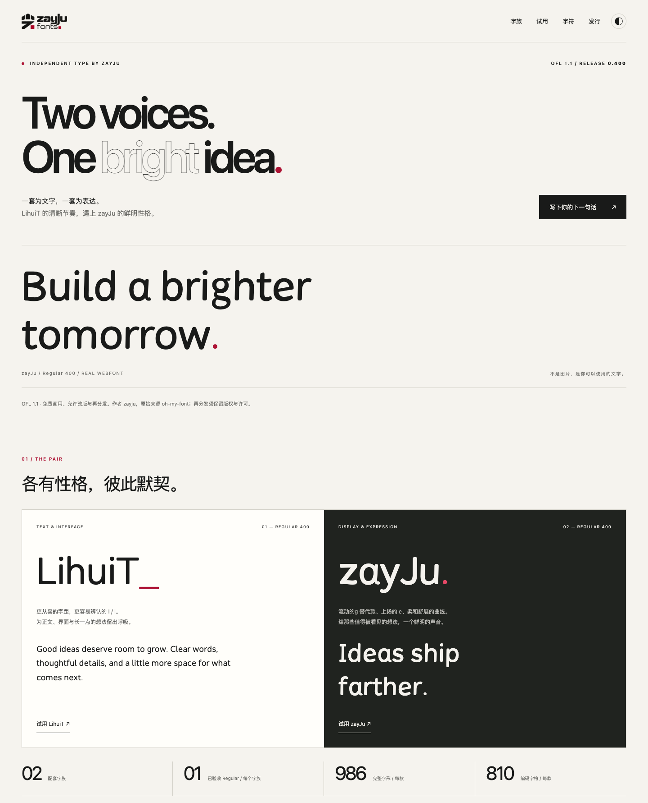

# LihuiT & zayJu

**Two voices. One bright idea.** Paired humanist and expressive sans-serif fonts by **zayju**.

[简体中文](README.zh-CN.md) · [Try the fonts](https://fonts.zayju.de/) · [v0.500 candidate](https://github.com/SheathedSharp/oh-my-font/releases/tag/v0.500) · [Published v0.400](https://github.com/SheathedSharp/oh-my-font/releases/tag/v0.400) · [Source & attribution](ATTRIBUTION.txt)



## Download and use

**Free for commercial use under SIL Open Font License 1.1.** No Reserved Font Names. The original author and source are included in the font metadata and every release package. Preserve the copyright notice and OFL license when redistributing the Font Software; no compulsory visible credit is added to ordinary artwork. See [license scope](LICENSE.md), [OFL.txt](OFL.txt) and [ATTRIBUTION.txt](ATTRIBUTION.txt).

Choose **TTF or OTF**, not both: they have the same desktop font identities. Choose **WOFF2** for a website. The `Website` archive contains the complete interactive specimen. Every package has license/source notices and internal hashes; Release-level `SHA256SUMS.txt`, `BUILD-MANIFEST.json` and `QA.json` bind the downloadable artifacts to their source. GitHub's automatic source archive is not the installable-font package.

## The pair

| Family | Role | Previous engineering name |
| --- | --- | --- |
| **LihuiT** | Text/interface; more generous spacing and distinguishable default I/l | Lihui |
| **zayJu** | Display; fluid curves, expressive B/M/R and a two-storey g | Zixian |

**Version 0.500 is the first multi-weight family on that redesign.** Each family has upright weights 100, 300, 400, 500, 600, 700, 800 and 900, plus a 10° Oblique of each weight: 32 styles, each in TTF, CFF OTF and WOFF2. Each style still contains **986 glyphs / 810 Unicode code points** and the same 21 OpenType features. Regular 400 upright is the owner-approved 0.400 drawing. The other uprights are stored masters; see [the weight notes](docs/design/0.500-weights.md). Oblique is labeled Oblique. It is not a separately drawn Italic.

The old [0.301 release](https://github.com/SheathedSharp/oh-my-font/releases/tag/v0.301) remains history. Do not mix it with 0.500. Deactivate older installs and choose **TTF or OTF**, not both. v0.400 stays the last published Release until v0.500 is tagged after visual review.

No Han, full Greek/Cyrillic, variable axis or monospaced coding family is included. [0.500 verification](docs/QA-0.500.md) keeps the existing Sigma case-mapping FAIL and records every warning. [Issue #3](https://github.com/SheathedSharp/oh-my-font/issues/3) still tracks broader coverage. New masters still need a human visual review before the Release is published.

## Build from source

Python 3.10+; dependencies are pinned. This never installs fonts automatically.

```sh
python3 build-local.py
```

Or with your own virtual environment:

```sh
python -m pip install -r requirements.txt
python build.py
python tools/prepare_site.py
python -m http.server 8136 --bind 127.0.0.1 --directory site
```

Open `http://127.0.0.1:8136/`. The specimen uses the built WOFF2 files: eight weights, Oblique, explicit loading failures, missing-character warnings, OpenType features, editable text, dark mode and responsive layouts. Outputs are under `dist/{ttf,otf,woff2}/{LihuiT,zayJu}/`.

## Verify and release

```sh
python -m pip install -r requirements-qa.txt
python tools/check_candidates.py
python tools/check_fontbakery.py
python tools/check_reproducibility.py
python tools/check_site.py  # local server + Google Chrome required
python tools/summarize_qa.py
```

The scoped FontBakery gate runs the full profiles and accepts only the precisely matched existing Sigma coverage finding; it does not pretend the raw profiles return zero. Native macOS checks, exact QA hashes, packaging and the release/deployment procedure are documented in [docs/RELEASING.md](docs/RELEASING.md). GitHub Actions verifies Linux builds and deploys the checksum-verified Website archive from Releases to Cloudflare Pages rather than silently rebuilding different fonts.

## Provenance

The source originated in the owner's Lihui/Zixian project. The current approved redesign uses individually editable UFO3/GLIF drawings under `design/full-01/sources`, with synchronized Glyphs-format companions. Historical geometry code under `src/` is not a production build input; tags preserve old releases. The original project and raster design boards remain untouched; see [provenance](docs/PROVENANCE.md). The build does not import or rename installed fonts. Dependencies are separately installed and retain their own licenses. OFL permission is not a guarantee of exclusive rights, perfect optical finishing or compatibility with every application.
